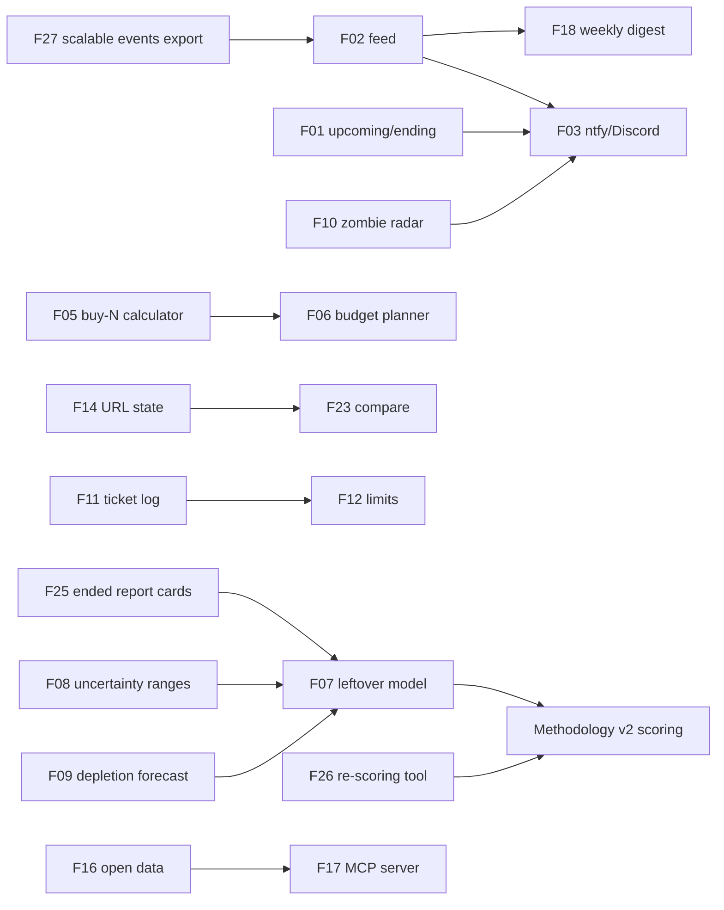

# Feature research

**Living document.** First written 2026-11-25. Future research sessions should read this file, [FEATURE_BACKLOG.md](FEATURE_BACKLOG.md) and [FEATURE_ROADMAP.md](FEATURE_ROADMAP.md) first, check what has shipped since, and *update* rather than regenerate (see [§21](#21-next-research-tasks-and-how-to-update-this-file)).

Evidence labels used throughout:
- **[V]** verified: seen in this repo, its production database, or on a fetched page.
- **[S]** from search summaries or secondary sources.
- **[I]** inference or judgment.

---

## 1. Project baseline

**What it is.** A free, open-source dashboard that ranks currently active New Jersey Lottery scratch-off games by their *remaining-prize profile*. Data comes from the official NJ Lottery JSON API. Live at https://madramdesign.github.io/nj-scratch/, rebuilt every 6 hours by GitHub Actions.

**Size.** About 6,800 lines of TypeScript across 4 packages and 2 apps. 96 tests pass (Vitest, node + jsdom) **[V]**. Seven commits on `main`, from 2026-11-21 to 2026-11-25.

**Production data** (`data` branch, pulled 2026-11-25) **[V]**:

| What | Value |
|---|---|
| Games known | 232 (65 active, 167 ended with tiers) |
| Game snapshots | 2,450 |
| Runs | 20 successful (9 Internet Archive backfill from 2024-11-14 → 2026-02-23, 11 live since 2026-11-22), 3 unchanged, 1 stale |
| Change events | 3,491 (261 top-prize claims, 135 major claims, 369 score changes, 112 status changes, 108 game added, 2,506 info) |
| Event rate | ~105–129 per live update, of which 1–8 are notable |
| Update rate | NJ data changes about twice a day; the job runs every 6 h |

## 2. Current capabilities

All of these are implemented and tested. Do not propose them as new.

| Area | Capability | Where |
|---|---|---|
| Ingestion | Official JSON API fetch with UA, timeout, retry/backoff | `packages/scraper/src/fetcher.ts` |
| Ingestion | Strict zod validation; fails loudly; per-game issue list | `packages/lottery-data/src/{raw-schema,parse,normalize}.ts` |
| Ingestion | Dedupe by payload hash (`unchanged` runs); rejects out-of-date CDN copies (`stale`) and retro-quarantines them | `packages/scraper/src/ingest.ts` |
| History | Append-only per-game and per-tier snapshots; gzipped raw payloads; Internet Archive backfill | `packages/database`, `packages/scraper/src/backfill.ts` |
| Analytics | Tickets-remaining estimate with refusal and confidence; recursive EV (free tickets), annuity cash value; current and launch odds per tier; retention ratios; profit odds | `packages/analytics/src/metrics.ts` |
| Scoring | Percentile composite, 5 components, adjustable weights and major threshold, top-prize cap, versioned methodology | `packages/analytics/src/scoring.ts`, `docs/SCORING_METHODOLOGY.md` |
| Explanations | Data-only strength/weakness/avoid sentences vs. price-point peers; banned-phrase tests | `packages/analytics/src/explain.ts` |
| Change detection | Top/major claims, score and label changes, status changes, structure revisions, new games; rebuildable | `packages/analytics/src/changes.ts` |
| Views | Best, All (filters/sorts), Jackpots, By price, Best odds, Remaining %, Avoid, Watchlist, Changes, Data quality, Methodology, Game detail (break-even, prize table, distribution and 5 history charts) | `apps/web/src/pages/*` |
| Hosting | Static export via the real Hono routes; in-browser re-scoring for custom weights; localStorage watchlist | `apps/api/src/export-static.ts`, `apps/web/src/static.ts` |
| Ops | Every DB copy kept as a commit on `data`; integrity and row-count checks before backup; staleness banner | `.github/workflows/update-and-deploy.yml`, `packages/scraper/src/verify-db.ts` |
| Phase 1 (2026-11-25) | Notable-change feeds (Atom/JSON, per price); pipeline-health issue; top-prizes-gone list and `top_prize_sold_out` events; Launches & Deadlines page with announced games; "buy N tickets" chances; same-price alternatives; notable-only change export | see FEATURE_BACKLOG "Phase 1 implementation notes" |
| API (self-hosted mode) | REST endpoints, manual refresh with cooldown and optional bearer token, in-process scheduler | `apps/api/src/{app,scheduler}.ts` |

## 3. Architecture summary

```
GitHub Actions (cron 17 */6) ─► restore DB from `data` branch ─► npm run scrape ─► tests ─► verify-db ─► commit DB to `data`
                                                                                         └► vite build (VITE_STATIC=1) + export-static ─► GitHub Pages
njlottery.com /api/v1/instant-games/games/?size=1000 ─► lottery-data (zod, normalize) ─► scraper/ingest (one transaction)
   ─► SQLite: raw_payloads, games, prize_tiers, game_snapshots, prize_snapshots, scoring_snapshots, change_events, update_runs, watchlist
   ─► api/DashboardService (analysis on read, cached per run × options) ─► Hono routes ─► static JSON ─► React + Recharts SPA
```

| Layer | Status |
|---|---|
| Frontend | React, Vite, Recharts, react-router; lazy game detail page; localStorage settings |
| Backend | Hono API (self-hosted mode only). The hosted site has no server. |
| Database | `node:sqlite`, WAL, forward-only migrations; Postgres-portable SQL |
| Authentication | None. Optional `ADMIN_TOKEN` for `POST /api/refresh`. |
| External services | njlottery.com (data), web.archive.org (backfill), GitHub Actions and Pages |
| Background jobs | Actions cron (hosted); in-process scheduler (self-hosted) |
| AI | None |
| Caching | In-memory analysis cache; NJ CDN `max-age=300`; static files on Pages |
| Monitoring | `update_runs` table, Data Quality page, stale banner. **No outbound alerting.** |
| Storage and backup | Git `data` branch (one commit per run) |

## 4. Current user workflows

| Workflow | Today | Friction | Ideal |
|---|---|---|---|
| **A. "Which ticket should I buy today?"** | Open Best Tickets, maybe change weights, open a game. | The answer is a ranking, but the real question is "with **$20** and a goal of *any profit* or *a shot at $1k+*, what should I buy?" The user has to translate. | Enter budget and goal and get the best options with exact probabilities and expected loss (F05, F06). |
| **B. "Did anything happen to the games I follow?"** | Star games, then come back and check the Watchlist page. | The user has to remember to visit. Alerts exist only on the page; Watchlist says "notifications aren't implemented yet" **[V]**. | Subscribe once (feed, ntfy, Discord) and get notified on top-prize claims, score drops and games ending (F02, F03). |
| **C. "Is this game still worth it?"** | Game detail page: EV, retention, history charts. | No sense of *uncertainty* or *trajectory*: when will it sell out, and how likely are remaining top prizes to be unclaimed rather than unsold? | Show ranges and depletion forecast, plus a "leftover-adjusted" view (F07, F08, F09). |
| **D. "Am I winning or losing overall?"** | Not supported. | Users track spend in their head; competitors sell this as PRO. | On-device ticket log showing actual vs. expected results, with spend limits (F11, F12). |
| **E. "What's new / ending?"** | Changes page shows "New game added" events. | Upcoming games are classified (`status: 'upcoming'`) but never stored or shown **[V]**. No view of games leaving sale or last day to claim. | Upcoming and Ending views (F01). |
| **F. Operator: "Is the pipeline healthy?"** | Check the Actions tab or the Data Quality page. | A failed scrape is only a `::warning::`; nobody is told **[V]**. | Auto-open and auto-close a GitHub issue on failed or stale runs (F04). |

## 5. Strengths and weaknesses

**Strengths [V]:**
- The most transparent methodology in the market. Published formulas, adjustable weights, refusal to estimate when data is thin, and "est." labels everywhere.
- Unique data assets: per-game time series back to 2024-11, discrete claim events, and cash-value treatment of annuities. Competitors either lack these or show them as aggregates (§6).
- Robust ingestion: strict validation, stale-copy rejection, dedupe, raw payload audit trail, and verified backups.
- Responsible framing: house-edge disclaimer, 1-800-GAMBLER, and tests ban "will win", "guaranteed" and "you should buy".
- Zero running cost (static hosting).

**Weaknesses:**

| Type | Detail |
|---|---|
| Missing automation | No outbound alerts for users or operator (B, F above). |
| Missing capability | No budget or goal answer; no uncertainty; no forecasting; no personal tracking. |
| Data quality | Remaining counts mix unsold and won-but-unclaimed prizes (acknowledged in docs). Not modeled, although the DB holds 167 ended games that could calibrate it (§11). |
| UX | Filters and sorts are not in the URL, so views can't be shared or bookmarked **[V]**. The SPA's `404.html` fallback means no crawlable per-game pages. |
| Scalability | Static `changes.json` holds the newest 1,000 events. At ~120 events per update and ~2 data changes per day, the hosted Changes page shows only about 4 days **[V]**. |
| Hidden capability | `upcoming` and `ended` statuses are computed. Ended games are stored, but neither is surfaced as a view. |
| Dead code | `ChangeKind` includes `game_removed`, which is never emitted **[V]**. |
| Hosted-mode gaps | Static watchlist has no notes, `added_at: 0` and no `score_at_add` **[V]** (`apps/web/src/static.ts`). |
| Ops risk | GitHub disables scheduled workflows after 60 days without repository activity **[S]**. Data commits go to the `data` branch; whether that counts as activity is unverified. |

**Unfinished work found:**
- Searches for TODO, FIXME, stubs and placeholders found **none** in code.
- The only explicit not-yet-built feature is notifications: `apps/web/src/pages/Watchlist.tsx:78`.
- `GITHUB_RESEARCH.md` lists the "buy N tickets" hypergeometric calculator as a "possible future feature".

## 6. Competitor research

Full notes were gathered 2026-11-25. lotterycalc.com returned 404 and lottoedge.com and lotterypost.com returned 403, so those profiles rely on secondary sources.

| Competitor | Model | Key features | Weak spots |
|---|---|---|---|
| **Lottery Valley** | Free / Plus $6–12/yr; affiliate links | 46 jurisdictions; published composite weights (35/25/25/15); per-tier current odds; est. tickets left | No history or change events; face value (not cash); a date inconsistency observed **[V]** |
| **Scratch Off Odds** | Free + PRO (tracker, simulator) | 43 states; daily sync; 7/30-day trends; "Dead Ticket / Zombie Game Radar"; published EV formula | NJ weekly stats internally inconsistent **[V]**; no cash/annuity handling |
| **ScratchSmarter** | $20–50/yr | 40+ states; opaque "SmartFactor"; games to avoid; education | Black-box score; "win more often" testimonials **[V]** |
| **LotteryCalc** | Unknown | NJ EV rankings by price **[S]** | Site down **[V]** |
| **LottoEdge** | Subscription, now white-label for news sites **[S]** | 35 states | — |
| **Lottery.net** | Affiliate (Jackpot.com) | Static top-prizes-left table, weekly | No EV or ranking |
| **NJ Lottery app** (official) | Free | Prizes remaining, ticket scanner, in-app claims, retailer locator, second chance **[V]** | No EV or ranking; 3.1★ |
| **ScratchOdds app** | Free + IAP $1.99–39.99 | 41+ states; **budget planner** recommending ticket combos; 8 goal modes; ending-soon and new-release tracking **[V]** | No alerts or log; opaque |
| **ScratchIQ** (iOS, 12/2025) | Free | AI ticket scanning, value score, alerts, favorites **[V]** | New, unrated |
| SmartScratcher, ScratchCheck, LuckBalance (log) | Various | "Game temperature" (hot/cold); spend logging | Gambler's-fallacy framing **[S]** |

### Feature gaps

- **Competitors have, we don't:**
  - alerts (ScratchIQ, Lottery Valley email)
  - budget and goal planner (ScratchOdds)
  - personal ROI tracker (Scratch Off Odds PRO, LuckBalance)
  - session simulator
  - dead/zombie-game radar (partly covered by our Avoid page)
  - ending-soon and new-release lists
  - multi-state coverage
  - native apps
  - ticket scanning
  - retailer directory
- **We have, competitors don't:**
  - per-game history charts
  - discrete claim and change events
  - retention metric
  - odds of winning *more than cost* (only Lottery Valley also has this)
  - user-adjustable weights
  - cash value for annuities
  - full methodology plus refusal-to-estimate
  - data freshness and quality page
  - stale-copy rejection
  - free and open source
- **Nobody does well (the opportunity):**
  1. **Unclaimed vs. unsold.** Everyone presents remaining prizes and EV as point values, ignoring claim lag and never-claimed prizes.
  2. **Uncertainty.** No one shows ranges.
  3. **Taxes.** No one shows after-tax EV.
  4. **Honest alerts** tied to real data changes rather than "hot" labels.
  5. **One loop** combining remaining-prize analytics with a personal log, limits and alerts.
  6. **Data freshness transparency.**

  Items 1, 2 and 5 are where this project can lead, because it already has the history to model them.

## 7. GitHub research

The 2026-11-21 survey is in [GITHUB_RESEARCH.md](GITHUB_RESEARCH.md). None of those ten repos had meaningful new activity as of 2026-11-25 **[V]**.

New trackers found (all 0★ personal projects; ideas only, no code reuse):

| Repo | License | Take-away |
|---|---|---|
| scubdon/california-scratchers-odds | none | Live per-level odds next to printed odds. We already have this per tier (`currentOddsOneIn` / `originalOddsOneIn`): **EXISTING — IMPROVE** visibility. |
| shredthaGNAR/calottery-scratchers-ev | MIT | "Edge vs launch" headline (current − launch EV, in points). We have both numbers and the chart; add the single delta. |
| ethan-leinberger/lottery-research | none | Monte Carlo "chance of profit vs. tickets bought" peaks at 2 tickets. Validates F05; we can compute it exactly. |
| LindsayWithAnA/mo-scratchers, seasonspresents/lottery-analyzer | none | On-device profit/loss tracker (F11). |
| myque08/savvymcp | none | MCP server over a paid scratch-off service, so there is demand for F17. |

Building blocks (verified stars, last push and license via `gh api` on 2026-11-25):

| Project | ★ | License | Use | Decision |
|---|---:|---|---|---|
| jpmonette/feed | 1,416 | MIT | Atom/RSS/JSON Feed generation | **Integrate** (F02) |
| binwiederhier/ntfy (ntfy.sh) | 35,756 | Apache-2.0 | Push via `curl` from Actions | **Integrate** via HTTP (F03) |
| vite-pwa/vite-plugin-pwa | 4,315 | MIT | Installable and offline | **Integrate** (F13) |
| simonw/datasette-lite | 419 | Apache-2.0 | Open the published `.db` in-browser | **Link** (F16) |
| vercel/satori + resvg-js | 14,218 / 2,017 | MPL-2.0 | Per-game preview images | Integrate later (F15) |
| stdlib-js/stdlib hypergeometric, jstat | 6,039 / 1,806 | Apache-2.0 / MIT | Hypergeometric | **Not needed.** About 20 lines with log-gamma (F05). |
| modelcontextprotocol/typescript-sdk | 13,823 | — | MCP server | Experimental (F17) |
| web-push-libs/web-push, resend-node | 3,579 / 986 | MPL / MIT | Web Push, email | Defer: both need subscriber storage |
| sql.js-httpvfs | 3,711 | Apache-2.0 | SQLite over HTTP range requests | Skip: inactive since 2024; JSON is sufficient |
| githubocto/flat | 484 | MIT | git scraping | Skip: archived |

## 8. Technology and environment research

- **Other states [V/S]:**
  - NJ is unusually rich: it publishes `totalTicketsPrinted` and per-tier paid and claimed counts.
  - **NY** (data.ny.gov Socrata, daily: paid/unpaid/total per tier) and **TX** (CSV with close dates) are machine-readable but have **no printed-ticket counts**, so EV needs odds-based estimation.
  - CA, PA, NC, CT, OH, DE and VA are HTML only.
  - MA has an SPA with no public prize endpoint found.
- **More NJ data in the same response [V]:**
  - 15 games with a future `launchDate` (upcoming).
  - `CLOSED` and ended games.
  - Across disabled games, **14.1% of printed prize value (~$632M of $4.49B) was never paid**: unsold tickets plus unclaimed prizes.
  - Other endpoints: `/api/v1/locations/` (~7,974 retailers, lat/long; inventory fields null) and `/api/v1/draw-games/games/`.
  - No public winners or news endpoint.
- **Claim rules [S]:**
  - Prizes are claimable up to one year after the announced close (N.J.A.C. 17:20-7.12).
  - Expiration dates are not printed on tickets.
- **Legal and policy [S/V]:**
  - 18 U.S.C. §1307 exempts state-lottery information.
  - Lottery age is 18 (bill A5197 would raise it to 21; stalled).
  - **Google Play bans gambling "companion functionality" with odds tracking as an example [V].** Apple 5.3 is also risky. The project should stay a website or PWA.
  - GitHub AUP bars get-rich-quick content, so avoid profit framing.
- **Notifications without a server:**
  - RSS/Atom: free, no personal data.
  - ntfy.sh: free, but the topic name is the only secret, so only publish to public read-only topics.
  - Discord/Telegram webhook: free; one secret.
  - Buttondown: free to 100 subscribers; RSS-to-email is $9/mo.
  - Web Push: needs subscription storage, so a server.
  - Resend: needs a subscriber list.
- **LLMs [I, pricing V]:**
  - Cost is trivial: about $0.004 per weekly summary on Haiku 5.5.
  - The risks are hallucinated numbers and persuasive language.
  - "Best $10 game with $100k left" is a filter over ~65 rows, so deterministic UI wins.
  - Acceptable uses:
    - phrasing-only polish of a templated digest, where code computes every number;
    - publishing machine-readable data that any assistant can read.
- **Evidence on value to buyers [S]:**
  - No documented regularly available scratch-off with EV > 1.
  - Srivastava (2003) exploited a ticket *design* flaw, not prize data.
  - States have ended games with grand prizes unawarded (MA: 2×$10M, 34×$1M), and FL had ~$1.1B unclaimed in two years.
  - Conclusion: a ranking can help avoid depleted games and pick the *least bad*. It must be framed as such.

## 9. Feature gap matrix

| Feature | We have | Competitors have | Opportunity | Priority |
|---|---|---|---|---|
| Notable-change alerts (feed/push) | No (on-page only) | ScratchIQ, Lottery Valley (email) | High: we have the best event data | **P0** |
| Upcoming / ending-soon / last day to claim | Partial (computed, not shown) | ScratchOdds app | High, near-free | **P0** |
| Zombie radar (top prizes gone, still selling) | Partial (Avoid page) | Scratch Off Odds | Medium | **P0** |
| Buy-N-tickets probability | No | Simulator (PRO) | High, exact math | **P0** |
| Budget / goal planner | No | ScratchOdds app | High | **P1** |
| Same-price better alternative | Partial (peer medians in explain) | No | Medium | **P0** |
| Unclaimed/leftover-adjusted EV | No | No one | **Very high (unique)** | **P1** |
| EV uncertainty ranges | No (only low-confidence flag) | No one | High (unique) | **P1** |
| Depletion forecast | No (history only) | No one | High (unique) | **P1** |
| Personal ROI log + limits | No | Scratch Off Odds PRO, LuckBalance | Medium-high | **P1** |
| After-tax EV | No (cash value yes) | No one | Medium (unique) | **P2** |
| History charts / claim events | **Yes** | Scratch Off Odds (aggregate) | Moat: improve | — |
| Adjustable weights / methodology | **Yes** | Lottery Valley (weights only) | Moat | — |
| Shareable views (URL state) | No | Partial | Medium | **P1** |
| PWA / mobile install | No (responsive site) | Native apps | Medium | **P1** |
| Open data / API | Partial (static JSON, undocumented) | No | Medium | **P1** |
| Multi-state | No | Most | Medium, expensive | **P2** |
| Ticket scanning | No | NJ app, ScratchIQ | Low for us | Reject |
| Accounts / sync | No | Several | Low (privacy, static) | Reject |
| Native apps | No | Several | Store policies hostile | Reject |
| Retailer map | No | NJ app, Scratch Off Odds | Low (no inventory data) | Experimental |

## 10. Feature candidates and scoring

**Scoring method.** Each feature is scored 1–10 on nine criteria.
- For **Cost** and **Risk**, 10 means cheap and safe, so higher is always better.
- Priority = weighted mean, using these weights:

| Criterion | Weight |
|---|---:|
| User value | 2 |
| Competitive advantage | 1.5 |
| Frequency | 1.25 |
| Revenue | 0.25 |
| Automation | 1 |
| Feasibility | 1 |
| Data availability | 1 |
| Cost | 1 |
| Risk | 1 |

- Revenue is down-weighted because the project is free and non-commercial.
- Size buckets: quick ≈ ≤ 2 days, medium ≈ 3–10 days, major ≈ 2+ weeks, experimental = R&D.
- The generator script is reproduced in [§22](#22-appendix-scoring-script) so scores can be re-run.

| Rank | ID | Feature | Size | User value | Comp. adv. | Frequency | Revenue | Automation | Feasibility | Data avail. | Cost (10=cheap) | Risk (10=safe) | **Priority** |
|---:|---|---|---|---:|---:|---:|---:|---:|---:|---:|---:|---:|---:|
| 1 | F02 | Atom/JSON feed of notable changes | quick | 7 | 8 | 7 | 3 | 9 | 10 | 10 | 9 | 9 | **8.25** |
| 2 | F03 | Push alerts via ntfy topics + Discord webhook | medium | 8 | 8 | 7 | 3 | 10 | 8 | 10 | 7 | 6 | **7.85** |
| 3 | F10 | Zombie-game radar (top prizes gone, still on sale) | quick | 7 | 6 | 6 | 3 | 8 | 10 | 10 | 9 | 9 | **7.72** |
| 4 | F01 | Upcoming & ending-soon / last-day-to-claim views | quick | 7 | 6 | 6 | 3 | 6 | 10 | 10 | 9 | 10 | **7.63** |
| 5 | F05 | "Buy N tickets" exact probability calculator | quick | 8 | 7 | 7 | 4 | 5 | 9 | 10 | 8 | 8 | **7.63** |
| 6 | F24 | "Better alternative at the same price" suggestions | quick | 7 | 7 | 7 | 3 | 6 | 9 | 10 | 8 | 9 | **7.60** |
| 7 | F06 | Budget & goal planner (best game for $X and a goal) | medium | 8 | 8 | 7 | 5 | 6 | 8 | 10 | 6 | 6 | **7.40** |
| 8 | F12 | Spend limits & reality checks (responsible play) | quick | 6 | 8 | 6 | 2 | 6 | 9 | 8 | 8 | 10 | **7.30** |
| 9 | F07 | Leftover/unclaimed-prize model calibrated on ended games | major | 8 | 10 | 6 | 4 | 7 | 6 | 9 | 4 | 7 | **7.25** |
| 10 | F18 | Weekly "what changed" digest page (templated) | medium | 6 | 7 | 5 | 3 | 9 | 8 | 10 | 7 | 8 | **7.15** |
| 11 | F09 | Sell-through velocity & depletion forecast | medium | 7 | 9 | 6 | 3 | 7 | 7 | 8 | 6 | 7 | **7.08** |
| 12 | F04 | Self-monitoring: auto-open GitHub issue on failed/stale runs | quick | 6 | 3 | 3 | 2 | 10 | 10 | 10 | 9 | 10 | **6.97** |
| 13 | F16 | Open data export (CSV/JSON + schema) + Datasette Lite link | quick | 5 | 7 | 3 | 3 | 6 | 10 | 10 | 9 | 9 | **6.90** |
| 14 | F11 | Personal ticket & ROI log (on-device) | medium | 7 | 7 | 8 | 5 | 4 | 8 | 8 | 6 | 7 | **6.88** |
| 15 | F08 | EV / odds uncertainty ranges | medium | 6 | 9 | 6 | 2 | 5 | 7 | 9 | 6 | 8 | **6.85** |
| 16 | F13 | Installable PWA + offline cache | quick | 6 | 5 | 7 | 3 | 3 | 9 | 10 | 8 | 9 | **6.80** |
| 17 | F14 | Shareable URLs for filters, sorts and weights | quick | 6 | 5 | 6 | 3 | 2 | 9 | 10 | 9 | 10 | **6.78** |
| 18 | F23 | Side-by-side game comparison | quick | 6 | 5 | 6 | 3 | 2 | 9 | 10 | 8 | 10 | **6.67** |
| 19 | F25 | Ended-game report cards / how games finished | medium | 5 | 8 | 3 | 3 | 6 | 8 | 9 | 7 | 9 | **6.55** |
| 20 | F28 | Data anomaly detection beyond stale responses | medium | 5 | 6 | 4 | 2 | 9 | 7 | 9 | 6 | 8 | **6.35** |
| 21 | F19 | After-tax EV toggle (federal + NJ withholding) | medium | 6 | 9 | 5 | 2 | 4 | 7 | 8 | 6 | 6 | **6.33** |
| 22 | F15 | Pre-rendered per-game pages + preview images (SEO) | medium | 5 | 6 | 5 | 6 | 5 | 7 | 10 | 6 | 8 | **6.28** |
| 23 | F27 | Scalable change-event export (paged/per-week files) | quick | 5 | 2 | 5 | 2 | 6 | 9 | 10 | 8 | 9 | **6.17** |
| 24 | F32 | Email digest via a newsletter service | medium | 6 | 4 | 5 | 4 | 9 | 6 | 10 | 5 | 4 | **5.92** |
| 25 | F31 | Web Push notifications | major | 6 | 5 | 6 | 3 | 9 | 4 | 10 | 3 | 4 | **5.78** |
| 26 | F17 | Read-only MCP server over the database | experimental | 4 | 6 | 3 | 3 | 5 | 7 | 10 | 6 | 7 | **5.65** |
| 27 | F26 | Methodology-versioned re-scoring from raw payloads | medium | 4 | 4 | 2 | 2 | 7 | 8 | 10 | 6 | 8 | **5.60** |
| 28 | F29 | Spanish translation | medium | 5 | 6 | 5 | 3 | 1 | 6 | 10 | 5 | 8 | **5.60** |
| 29 | F22 | Multi-state support: NY (Socrata) + TX (CSV) | major | 7 | 6 | 6 | 8 | 6 | 4 | 6 | 2 | 5 | **5.55** |
| 30 | F30 | Privacy-friendly usage analytics | quick | 4 | 1 | 2 | 4 | 5 | 9 | 4 | 8 | 7 | **4.60** |
| 31 | F37 | Hot/cold "game temperature" labels | quick | 2 | 1 | 5 | 3 | 3 | 9 | 8 | 9 | 1 | **4.25** |
| 32 | F21 | Retailer map from NJ locations API | experimental | 3 | 3 | 3 | 3 | 3 | 7 | 6 | 5 | 5 | **4.10** |
| 33 | F33 | Natural-language Q&A chatbot | experimental | 3 | 3 | 4 | 3 | 3 | 5 | 10 | 4 | 2 | **4.03** |
| 34 | F20 | Second-chance (VIP Replay) value in EV | experimental | 3 | 5 | 4 | 2 | 3 | 5 | 3 | 6 | 4 | **4.00** |
| 35 | F36 | Native iOS/Android apps | major | 4 | 3 | 6 | 5 | 2 | 3 | 10 | 2 | 1 | **3.92** |
| 36 | F35 | Accounts & cross-device sync | major | 4 | 2 | 5 | 5 | 2 | 4 | 6 | 2 | 3 | **3.55** |
| 37 | F34 | Ticket scanning / OCR | experimental | 3 | 2 | 4 | 3 | 4 | 3 | 3 | 2 | 3 | **2.98** |

**Adjustments to the raw ranking:**
- **F28** (anomaly detection) is folded into F04, because both are operator monitoring.
- **F19** (after-tax EV, rank 21) is promoted into the Top 20. No competitor has it, and cost alone shouldn't exclude it.
- **F27** is a small reliability fix, so it is scheduled in Phase 1 regardless of score.

**Existing features to improve rather than rebuild:**

| Feature | Status | Improvement |
|---|---|---|
| Avoid page | EXISTING — IMPROVE | Becomes F10. |
| Peer comparison in `explain.ts` | EXISTING — IMPROVE | Becomes F24. |
| Per-tier current vs. launch odds | EXISTING — IMPROVE | Make more prominent; add an "edge vs launch" delta. |
| Watchlist alerts | EXISTING — IMPROVE | Add outbound delivery (F02, F03). |
| Low-confidence ticket estimate | EXISTING — IMPROVE | Turn into ranges (F08). |

## 11. Data opportunities (from data we already have)

1. **Leftover calibration (F07).**
   - Evidence: the DB holds 167 ended games with final tier counts. When sales stopped, **29% of top-tier prizes were still unclaimed** (38,734 of 132,787) **[V]**. The API shows 14.1% of prize value is never paid on disabled games **[V]**.
   - Opportunity: watching ended games through their one-year claim window separates *unsold* (never claimed) from *claimed late*. That gives an empirical "probability a remaining top prize is actually in circulation". No competitor models this.
2. **Sell-through velocity (F09).** `scoring_snapshots.tickets_remaining_est` over time gives tickets per day per game. Example: #1816 went from 2.45M to 1.42M over 12 months **[V]**. Use it to forecast sell-out and the top-prizes-left trajectory.
3. **Top-prize claim pace vs. sales pace.**
   - Already partially captured as retention.
   - Add a *trend*: retention rising means big prizes are lagging sales.
4. **Exact session probabilities (F05, F06).** Tier counts plus estimated tickets left give a hypergeometric P(≥1 prize ≥ $X in N tickets) and P(net profit).
5. **Ended-game outcomes (F25).** "How did games like this finish?" Final EV vs. launch EV and how long top prizes lasted, by price point.
6. **Anomaly signals (F04/F28).** Paid counts that jump implausibly, structure revisions and stale copies already produce events. Promote these to operator alerts.
7. **Launch calendar (F01).** Upcoming games (future `launchDate`) and `disableDate − 365 d` give "sales end" and "last day to claim" with no new source.

## 12. Automation opportunities

| Manual today | Automation | Feature |
|---|---|---|
| Checking the site for changes | Feed + push on notable events | F02, F03 |
| Operator watching Actions | Issue opened/closed automatically on failed or stale runs, or no new data for 36 h | F04 |
| Noticing games about to end, or prizes to claim before the deadline | Scheduled "ending in 30 days / last day to claim" alerts | F01 + F03 |
| Translating a ranking into a purchase plan | Budget and goal planner | F06 |
| Remembering spending | On-device log with limit warnings | F11, F12 |
| Writing "what changed this week" | Templated weekly digest page and feed item | F18 |
| Re-scoring history after a methodology change | Rebuild `scoring_snapshots` from `raw_payloads` | F26 |
| Keeping the scheduled workflow alive (60-day rule) | Heartbeat check inside F04 | F04 |

## 13. AI opportunities (skeptical)

| Idea | Verdict |
|---|---|
| NL Q&A chatbot | **Reject.** A deterministic filter answers it exactly. Needs a backend or user key. Hallucination and persuasion risk. |
| Weekly digest written by an LLM | **Optional polish only** (F18). Code computes every number and fills a template; an LLM may rephrase, with a validator checking all numbers still match. Haiku-class cost ≈ $0.004/week. The template alone is the default. |
| MCP server | **Experimental** (F17). Publishing documented CSV/JSON (F16) gets most of the benefit with no hosting. A stdio MCP server for local use is cheap if there is demand. |
| AI ticket scanning | **Reject** (F34). The NJ app already checks winners; liability; no data benefit. |
| ML forecasting | Not needed. Simple trend fits plus Bayesian shrinkage on ~200 games' history beat a black box and stay explainable (F07, F09). |

## 14. Top 20 features

Ordered by adjusted priority. Full specifications are in [FEATURE_BACKLOG.md](FEATURE_BACKLOG.md).

| # | ID | Feature | Problem solved | Reuse | New infra | Size | Depends on | Key risk | Priority / phase |
|---:|---|---|---|---|---|---|---|---|---|
| 1 | F02 | Notable-changes feed (Atom + JSON Feed, global and per price) | Users must revisit to learn of claims | `change_events`, `export-static.ts` | `feed` package; `feed.xml` | quick | F27 | Feed spam if info events leak | P0 / 1 |
| 2 | F03 | Push alerts: ntfy topics + Discord webhook | No proactive notification | F02 event selection; Actions job | Secrets; notify step | medium | F02 | Public topics; tone | P0 / 3 (after 001; can move to 1) |
| 3 | F10 | Zombie radar | Users buy games whose top prizes are gone | Avoid page, `topPrize.remaining` | Event "top prize sold out" | quick | — | — | P0 / 1 |
| 4 | F01 | Upcoming & ending views | New and ending games invisible | `classifyStatus` (`upcoming`, `ended`), `disableDate` | Snapshot `upcoming` metadata | quick | — | Date semantics | P0 / 1 |
| 5 | F05 | Buy-N-tickets calculator | "What are my chances with 5 tickets?" | `tiers`, `ticketsRemaining` | `analytics/session.ts` | quick | — | Mis-reading as advice | P0 / 1 |
| 6 | F24 | Better alternative at same price | Users don't know a peer is better | `explain.ts` peers, `rankInPrice` | — | quick | — | — | P0 / 1 |
| 7 | F04 | Pipeline self-monitoring (+ F28) | Silent failures and stale data | `update_runs`, `verify-db` | `gh issue` step | quick | — | Noise | P0 / 1 |
| 8 | F12 | Spend limits & reality checks | Responsible play; trust | Settings in localStorage | — | quick | F11 (soft) | Paternalism | P1 / 2 |
| 9 | F06 | Budget & goal planner | Ranking ≠ purchase decision | F05 | Planner page | medium | F05 | Optimizing a negative-EV purchase must stay framed as "least bad" | P1 / 2 |
| 10 | F14 | Shareable URL state | Can't share or bookmark views | Filters, settings | — | quick | — | — | P1 / 2 |
| 11 | F13 | Installable PWA | Mobile use at the store | Vite build | `vite-plugin-pwa` | quick | — | Stale cache | P1 / 2 |
| 12 | F16 | Open data export + docs | Researchers and assistants can't consume the data | static JSON | CSV + schema + datasette-lite link | quick | — | Bandwidth | P1 / 2 |
| 13 | F11 | Personal ticket & ROI log | "Am I up or down?" | `GameSummary`, EV | localStorage store; export/import | medium | — | Privacy (stays on device) | P1 / 2 |
| 14 | F23 | Side-by-side comparison | Choosing between 2–3 games | Game detail components | Compare page | quick | F14 | — | P1 / 2 |
| 15 | F18 | Weekly digest | Signal buried in ~120 events per update | `change_events`, `scoring_snapshots` | digest generator | medium | F02 | — | P1 / 3 |
| 16 | F09 | Depletion forecast | "When will this sell out?" | `scoring_snapshots` history | `analytics/forecast.ts` | medium | — | Sparse history early on | P1 / 4 |
| 17 | F08 | Uncertainty ranges | Point EV is falsely precise | `estimateTickets` spread | Interval math in metrics | medium | — | UI complexity | P1 / 4 |
| 18 | F07 | Leftover-adjusted EV | Unclaimed vs. unsold confounds everything | ended-game snapshots | calibration job + table | major | F09, F08 | Model error; needs months of ended-game tracking | P1 / 4 |
| 19 | F25 | Ended-game report cards | Learn how games finish | ended snapshots | page | medium | F07 (shares data) | — | P2 / 4 |
| 20 | F19 | After-tax EV toggle | Big prizes are worth less after withholding | tiers, cash value | tax table (versioned) | medium | — | Tax rules wrong or changing; not tax advice | P2 / 4 |

## 15. Top 5 game changers

### 1. Leftover-adjusted EV and "is that top prize really out there?" (F07, with F08)
- **Why it matters.** Every tracker, including this one, treats a remaining top prize as available. Ended-game data says ~29% of top-tier prizes are still unclaimed when sales stop, and MA has ended games with 34 × $1M unawarded. Without this correction, rankings systematically overrate late-stage games.
- **Why now.** The DB already has 167 ended games and the pipeline snapshots them every run. The one-year claim window means calibration data accrues automatically.
- **Why competitors lack it.** They don't keep per-game history, and their per-state scrapers aren't built around one rich source.
- **Difficulty.** Separating unsold from late-claimed needs games observed through to expiry. Small samples per price point.
- **Incremental build:**
  1. Report-card stats on ended games (F25).
  2. An empirical "share of top prizes still unclaimed at end of sales" by price, used as a *displayed caveat*.
  3. Bayesian shrinkage per game to produce an adjusted EV range.
  4. Optional scoring component, behind a methodology version bump.

### 2. Honest alerts (F02, F03, F01, F10)
- **Why it matters.** Event data is our moat, but it is pull-only. Alerts turn the site into something that comes to the user.
- **Why now.** Events already exist. Feeds and ntfy are free and serverless.
- **Why competitors lack it.** Most have no event model; their alerts are generic.
- **Difficulty.** Choosing a signal threshold (about 3 notable events per update is right), neutral tone, and keeping ntfy topics publish-only from CI.
- **Incremental build:**
  1. Atom feed.
  2. ntfy and Discord.
  3. Per-price topics.
  4. Upcoming, ending and zombie events.

### 3. Budget & goal planner (F05 → F06)
- **Why it matters.** It answers the real user question with exact probabilities: "with $20, which ticket(s) give the best chance of any profit, or of at least one prize ≥ $1,000?" It also shows the expected loss.
- **Why now.** Tier counts and ticket estimates already exist, and the math is about 20 lines.
- **Why competitors lack it.** The one that has it (ScratchOdds app) is opaque, and nobody shows the expected-loss side.
- **Difficulty.** Combinations across games (a small knapsack over ≤ 10 tickets) and honest framing.
- **Incremental build:**
  1. Single-game N-ticket panel.
  2. Single-game best-for-budget.
  3. Mixed baskets.

### 4. Depletion forecast (F09)
- **Why it matters.** "This game sells out in about 6 weeks; at current pace about 3 of 7 top prizes will be claimed by then." It turns static snapshots into a trajectory.
- **Why now.** History back to 2024-11 plus twice-daily live data.
- **Why competitors lack it.** No per-game history.
- **Difficulty.** Irregular snapshot spacing; sales are seasonal; must show ranges.
- **Incremental build:**
  1. Tickets-per-day rate.
  2. Linear projection with an interval.
  3. Top-prize claim-rate projection.

### 5. Honest companion loop: personal log + limits (F11, F12)
- **Why it matters.** It ties analytics to the user's real outcomes and builds in responsible play: actual vs. expected loss, and monthly limit warnings. It is the strongest trust differentiator against "win more" competitors.
- **Why now.** Static hosting plus localStorage means no privacy cost.
- **Why competitors lack it.** They sell trackers as PRO and avoid showing expected loss.
- **Difficulty.** Device-only data (export and import JSON) and keeping it from feeling like a gambling log that encourages play.
- **Incremental build:**
  1. Limit plus reality-check banner.
  2. Ticket log.
  3. Actual vs. expected chart.

## 16. Dependencies



| Feature | Must exist first | DB changes | API / export | Infrastructure | Reuses |
|---|---|---|---|---|---|
| F01 | — | Store `upcoming` games (new `upcoming_games` table or snapshot status) | `upcoming.json`; status fields | — | `classifyStatus`, `disableDate` |
| F02 | F27 | — (optional `notified_at`) | `feed.xml`, `feed.json` | `feed` npm | `listEvents` |
| F03 | F02 | `notifications` log for idempotency | — | Actions secrets (`NTFY_TOPIC_PREFIX`, `DISCORD_WEBHOOK_URL`) | events |
| F04 | — | — | — | `gh issue` with `GITHUB_TOKEN` (`issues: write`) | `update_runs`, `status()` |
| F05/F06 | — | — | — (client-side) | — | `tiers`, `tickets` |
| F07 | F08, F09, F25 | `calibration` table (versioned) | fields on `GameMetrics` | — | ended snapshots |
| F09 | — | — (derived) | `forecast` on game | — | `scoring_snapshots` |
| F11/F12 | — | — (localStorage) | — | — | `GameSummary` |
| F13 | — | — | — | `vite-plugin-pwa` | Vite build |
| F16 | — | — | CSV export + publish `.db` to Pages | — | `export-static.ts` |
| F19 | — | — | `afterTaxEv` | tax config file | `evFrom` |

## 17. Reusable building blocks

| Block | Location | Use in |
|---|---|---|
| `analyzeGames`, `computeGameMetrics`, `evFrom` | `packages/analytics` | F05–F09, F19 (runs in the browser too) |
| `diffGame`, `rebuildChangeEvents` | `analytics/changes.ts`, `scraper/ingest.ts` | F01, F10 events; F26 rebuild |
| `export-static.ts` (renders real routes) | `apps/api` | F02, F16, F18, F27 outputs |
| `static.ts` adapter | `apps/web` | Any new endpoint must be added here for Pages |
| `update_runs`, `status()` warnings | database, service | F04 |
| `raw_payloads` (gzip) | database | F26 re-scoring; research |
| `verify-db.ts` | scraper | Extend for new tables |
| Settings and watchlist contexts (localStorage) | `apps/web/src` | F11, F12, F14 |
| Recharts `HistoryChart` | `components/Charts.tsx` | F09, F25 |

**Rule:** extend these rather than build parallel systems. Every new view must work in both modes: API and static.

## 18. Security & reliability review

- **Secrets.**
  - ntfy topic names and the Discord webhook go in Actions secrets.
  - ntfy topics are writable by anyone who knows the name. Publish only to topics whose names include an unguessable suffix, and document that subscribers have read-only use.
  - Never print secrets in logs.
- **Idempotency.**
  - Re-runs (push to `main` also triggers the workflow) must not re-send alerts.
  - Keep a `notifications(event_id, channel, sent_at)` table in the DB on the `data` branch, and send only events newer than the last sent.
- **Rate limits.**
  - Cap pushes per run (e.g. ≤ 10, then "and N more").
  - ntfy limits are unverified.
- **Data validation.** Alerts are generated only from `success` runs, never `stale` or `failed`.
- **Privacy.**
  - F11 and F12 stay on-device: no accounts, no upload. Export and import are files.
  - No analytics that fingerprint (F30 only if cookieless).
- **Tone and abuse.**
  - Alert copy is neutral ("2 × $100,000 claimed; 3 left"), never "buy now".
  - Extend the banned-phrase test to feeds and notifications.
- **Legal.** Stay web/PWA (Google Play policy). Keep the not-affiliated disclaimer, 18+ notice and 1-800-GAMBLER in feeds too.
- **Model risk (F07–F09).**
  - Always show intervals and the methodology version.
  - Re-scoring old history uses F26, not ad-hoc edits.
- **Rollback.**
  - Each `data` commit is a DB backup.
  - New tables must pass `verify-db` row-count checks. Its "rows may not shrink" rule must account for rebuildable tables.
- **Workflow liveness.**
  - F04 alerts when no successful run happens for more than 36 h.
  - Verify whether `data`-branch pushes count toward the 60-day rule.

## 19. Rejected and deferred ideas

| Idea | Verdict | Why |
|---|---|---|
| Hot/cold "game temperature" (F37) | **Reject** | Gambler's fallacy. Each ticket's odds depend on remaining counts, which we already show, not on "streaks". It contradicts the project's honesty positioning. |
| Natural-language chatbot (F33) | **Reject** | A filter over ~65 rows answers it exactly. Needs a backend or key. Hallucination and persuasion risk. |
| Ticket scanning / OCR (F34) | **Reject** | The official app already checks winners. No analytic value. Liability if wrong. |
| Native iOS/Android apps (F36) | **Reject** | Google Play explicitly bans odds-tracking "companion" apps; Apple 5.3 is risky. A PWA (F13) covers it. |
| Accounts & cross-device sync (F35) | **Reject (for now)** | Requires a server and stores personal gambling data. Export/import files cover the need. |
| Retailer map (F21) | **Defer** | The NJ locations API has no inventory or "winning ticket sold here" data (fields null). "Lucky store" framing is fallacious. |
| Second-chance value in EV (F20) | **Defer** | Value per entry is tiny and unpublished (drawing entries vary). It adds model noise. |
| Web Push (F31) | **Defer** | Needs subscription storage, so breaks the zero-server model. Revisit only if ntfy and feed adoption shows demand. |
| Self-managed email list (F32) | **Defer** | Privacy burden. If wanted, use Buttondown's RSS-to-email over F02, not our own list. |
| Multi-state (F22) | **Defer to Phase 5** | NY and TX lack printed-ticket counts, so EV quality drops. Depth in NJ is the competitive edge; breadth is where competitors are strongest. |
| Client-side SQLite / DuckDB-WASM | **Reject** | Several MB of download to query data we already precompute as small JSON. |
| Affiliate "buy" links / ads | **Reject** | Conflicts of interest undermine the core trust advantage; GitHub AUP and responsible-gambling concerns. |
| ML / deep-learning forecasting | **Reject** | Too little data per game. Simple, explainable statistics are better and auditable. |

## 20. Open questions

1. Do pushes to the `data` branch keep scheduled workflows enabled under GitHub's 60-day inactivity rule?
2. ntfy.sh public-server rate limits and terms for automated publishers.
3. Exact NJ and federal withholding rules for lottery prizes, needed for F19. The assumed values (24% federal over $5,000; NJ 5% for $10,001–$500,000 and 8% above) **must be verified** against current NJ Division of Taxation guidance.
4. Does `CLOSED` reliably mean "sales ended, claims open"? Confirm against games' `disableDate` over time.
5. How quickly does NJ update `paidTickets` (time of day)? It matters for alert timing.
6. Is there demand for multi-state, or is NJ depth the better strategy? Usage analytics (F30) would answer this.
7. What share of the 29% unclaimed top-tier prizes at end of sales is later claimed? This requires tracking ended games to expiry and is the core of F07.

## 21. Next research tasks, and how to update this file

**Next research tasks:**
- Re-measure the leftover statistic monthly, as more ended games expire.
- Verify the tax rules (Q3).
- Test ntfy limits (Q2).
- Re-check competitors quarterly (LotteryCalc relaunch? ScratchIQ traction?).
- Watch NY Socrata for added ticket counts.
- Check new GitHub trackers with `gh search repos "scratch off" --sort updated`.

**Update protocol for future sessions:**
1. Read all three feature docs.
2. Run `git log` since the "Last reviewed" date below.
3. Mark shipped backlog items `Status: Shipped (commit)` and move them to *Current capabilities* (§2).
4. Re-run the scoring script (§22) after editing scores, and replace the §10 table.
5. Append new sources to §23 with the date.
6. Never delete rejected ideas. Move them to the rejected list with the reason.

**Last reviewed:** 2026-11-25 (Phase 1 built the same day).

## 22. Appendix: scoring script

```js
// node score.mjs > table.md   — F = [id, name, size, UV, CA, Freq, Rev, Auto, Feas, Data, Cost(10=cheap), Risk(10=safe)]
const W = { uv: 2, ca: 1.5, fq: 1.25, rv: 0.25, au: 1, fe: 1, da: 1, co: 1, ri: 1 };
const sw = Object.values(W).reduce((a, b) => a + b);
const priority = ([uv, ca, fq, rv, au, fe, da, co, ri]) =>
  (uv * W.uv + ca * W.ca + fq * W.fq + rv * W.rv + au * W.au + fe * W.fe + da * W.da + co * W.co + ri * W.ri) / sw;
// Score rows are the §10 table columns; sort by priority descending.
```

## 23. Research sources

Accessed 2026-11-21 → 2026-11-25.

- **This repo:** all files under `apps/`, `packages/`, `docs/`, `.github/`, `fixtures/`; production DB from `origin/data`; `npm test` (96 passing).
- **NJ:**
  - https://www.njlottery.com/api/v1/instant-games/games/?size=1000
  - `/api/v1/locations/`, `/api/v1/draw-games/games/`
  - N.J.A.C. 17:20-7.12 (regulations.justia.com)
  - nj.gov/humanservices/dmhas (1-800-GAMBLER)
  - legiscan A5197
- **Competitors:**
  - lotteryvalley.com (/new-jersey/scratch-offs/best, /membership)
  - scratchoffodds.com (/about, /new-jersey)
  - scratchsmarter.com/pricing
  - lottery.net/new-jersey/scratch-offs
  - App Store ids 493036278 (NJ Lottery), 6504375787 (ScratchOdds), 6755447466 (ScratchIQ), 982201272 (LuckBalance)
  - producthunt.com/products/scratchcheck
  - localmedia.org (LottoEdge 2025)
  - axios.com (LottoEdge 2019)
  - nj1015.com
- **Other states:**
  - data.ny.gov/api/views/nzqa-7unk
  - texaslottery.com scratchoff.csv
  - calottery.com, palottery.state.pa.us, nclottery.com, ctlottery.org, ohiolottery.com, delottery.com, valottery.com, masslottery.com
  - Michigan lottery FAQ
- **Policy:**
  - Google Play gambling policy (support.google.com/googleplay/android-developer/answer/9877032)
  - Apple guideline 5.3 forum thread
  - GitHub Acceptable Use Policies
  - GitHub Actions workflow-disable docs
  - 18 U.S.C. §1307 (law.cornell.edu)
- **Notifications:** docs.ntfy.sh/publish, buttondown.com/pricing, resend.com pricing, Apple web push docs.
- **Evidence:**
  - cbsnews.com (MA unawarded grand prizes)
  - wuft.org (FL unclaimed)
  - abc7.com (NC removal lag)
  - Wired/Gizmodo (Srivastava)
  - inquirer.com and Wikipedia (Ginther)
  - USPTO patent 10403088
- **GitHub:**
  - the 10 repos in GITHUB_RESEARCH.md
  - scubdon/california-scratchers-odds, shredthaGNAR/calottery-scratchers-ev, restlessbenjamin/BoringRight-, lkakashv213-H/win-big-in-texas, seasonspresents/lottery-analyzer, LindsayWithAnA/mo-scratchers, myque08/savvymcp, ethan-leinberger/lottery-research
  - jpmonette/feed, binwiederhier/ntfy, caronc/apprise, web-push-libs/web-push, resend/resend-node, simonw/{git-history, datasette-lite, sqlite-utils, datasette, shot-scraper}, phiresky/sql.js-httpvfs, sqlite/sqlite-wasm, rhashimoto/wa-sqlite, duckdb/duckdb-wasm, vite-pwa/vite-plugin-pwa, vercel/satori, thx/resvg-js, modelcontextprotocol/typescript-sdk, githubocto/flat, jstat/jstat, stdlib-js/stdlib, simple-statistics
